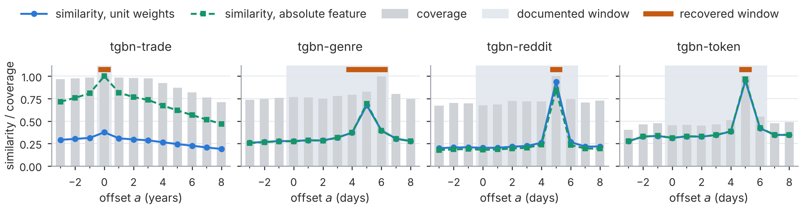

# Temporal Leakage Distorts the TGB Node Affinity Leaderboard: A Point-in-Time Audit

This repository contains the code, the reference outputs and the reproduction scripts of the
paper *Temporal Leakage Distorts the TGB Node Affinity Leaderboard: A Point-in-Time Audit*
[Experiment, Analysis & Benchmark].

## Overview

Every label of a node affinity benchmark has a **query time** t_q, at which a model must predict
it, and an **availability time** t_a, by which all interactions it summarizes have occurred. An
evaluation is point-in-time correct if, when predicting at t_q, a model has processed only edges
stamped before t_q and has received only labels with t_a ≤ t_q. The reference evaluation loop of
the [Temporal Graph Benchmark (TGB)](https://github.com/shenyangHuang/TGB) violates this on all
four node affinity datasets:

* **Early label release** (tgbn-genre, tgbn-reddit, tgbn-token). Each label summarizes a single
  day about five days after its timestamp, not the documented following week, yet the loop feeds
  it back right after scoring it, so label-based methods see five to six days ahead.
* **Same-timestamp edges** (tgbn-trade). The label of year Y is computed from the edges of year Y,
  all of which the loop processes before predicting Y; a parameter-free edge counter scores
  NDCG@10 = 1.000.
* **Batch-boundary edges** (all datasets; known as TGB issue #53). Up to two batches of later
  edges are processed before a prediction; on these datasets they carry almost no information.

The repository provides a label-window probe that recovers which window each label summarizes,
an instrumented evaluation stream that replays the TGB loop and measures each violation, and a
drop-in leakage-free protocol (a strict edge cutoff and delayed label release), together with
everything needed to re-evaluate the training-free heuristics and NAVIS under both protocols.



*Figure 2 of the paper: on the daily datasets, similarity and coverage peak at a single day five
to six days after the stamp instead of spanning the documented following week (gray band); the
orange bar marks the window recovered by the probe.*

## Repository structure

```
label_probe/          label-window probe (Section 3.1); runs on TGB or on any edge/label CSV files
tgbn_audit/           evaluation stream, leakage-free protocol and training-free heuristics
  protocol.py         NodeAffinityStream: the TGB loop with both switches (Algorithm 1)
  data.py             loading of the TGB datasets, availability delays, TGB MovingAverage windows
  heuristics.py       label and edge channels and their blends
  pipeline.py         heuristic runs: train pass, validation pass (blend fitting), test pass
  metrics.py          exact NDCG@10, identical to the scikit-learn function used by TGB
  stats.py            paired bootstrap confidence intervals and Wilcoxon tests
  placebo.py          within-period shuffle (Section 6.3)
scripts/              one script per experiment, table and figure (see "Reproducing the paper")
navis/                patch that adds the two switches to NAVIS, and the files it needs
tests/                synthetic tests of the probe and the protocol (no data, no GPU)
reproduce.py          single entry point for every step
reference_results/    our outputs; reference_results/tables.md holds every number of the paper
```

## Requirements

* Python ≥ 3.9.
* Probe, protocol, heuristics and tables (CPU only): NumPy ≥ 1.24, SciPy ≥ 1.10,
  scikit-learn ≥ 1.2, and [py-tgb](https://pypi.org/project/py-tgb/) 2.3.0 for the datasets.
* Optional: pandas ≥ 1.5 for CSV input to the probe, matplotlib ≥ 3.6 for the figures,
  pytest for the tests.
* NAVIS runs only: the dependencies of [NAVIS](https://github.com/orfeld415/NAVIS) (PyTorch,
  PyTorch Geometric, tqdm, matplotlib) and a GPU. We used PyTorch 2.10 with CUDA 12.8.
  pytorchltr is not needed (see [Third-party code](#third-party-code)).

```bash
pip install -r requirements.txt     # everything except the NAVIS dependencies
python reproduce.py test            # synthetic tests, about two minutes, no data needed
```

## Datasets

py-tgb downloads each dataset on first use into its own package directory
(`<site-packages>/tgb/datasets/`), whatever the working directory. tgbn-token takes well over
10 GB and a lot of memory; on a small disk, move its folder and leave a symbolic link in its place.

py-tgb 2.3.0 returns the logarithm of the tgbn-token edge feature only when it reads its cached
files, and the raw amounts on the first load after a download. Our loaders apply the logarithm
in both cases, and `reproduce.py navis` loads every dataset once before the NAVIS runs, so that
all results use the logarithm (Section 4.2 of the paper).

## Reproducing the paper

```bash
python reproduce.py probe          # label windows                    -> results/probe/
python reproduce.py loop           # loop diagnostics                 -> results/loop/
python reproduce.py heuristics     # heuristics, both protocols (CPU) -> results/heuristics/
python reproduce.py navis --navis_dir NAVIS/NAVIS                    # GPU -> results/navis/
python reproduce.py tables         # results/tables.md, tables.tex, protocol_comparison.md
python reproduce.py figure         # results/figures/probe.pdf, inputs.pdf, memory.pdf
```

`python reproduce.py all` runs every step except NAVIS. `--only tgbn-genre,tgbn-trade` restricts
a step to some datasets, and `--dry_run` prints the commands without running them.
`python scripts/make_tables.py --results reference_results` rebuilds the tables from our own
outputs; it lists every missing input together with the command that produces it.

| Paper | Content | Step | Reference value |
|---|---|---|---|
| Table 3, Figure 2 | label windows and availability delays | `probe`, `figure` | reddit, token: [t+5, t+6) d; genre: one day ending by t+7 d (probe window [t+4, t+7) d); trade: [t, t+1) yr |
| Table 3, S1 | edges processed at / after t_q, all splits | `loop` | trade 19,126 per query; daily ≈ 100, within hours |
| S2 (Section 4.4) | gain from each form of leakage | `heuristics` | edge counter +0.145 (trade); PF +0.046 / +0.061 / +0.068; recency counter ≤ 0.0002 |
| Table 4 | scores under both protocols | `heuristics`, `navis` | label-based −3% to −17% on the daily datasets; trade edge aggregation 1.000 → 0.863 |
| Section 5.2 | paired tests | `tables` | per method and dataset, in `protocol_comparison.md` |
| Figure 3, S4 | label minus edge | `tables`, `figure` | blends: genre +0.005 → −0.017, reddit +0.023 → +0.001, token +0.066 → +0.004 |
| Table 5 | ranks and Kendall's τ | `tables` | τ = 0.90 / 0.59 / 0.69 / 0.46 (trade, genre, reddit, token) |
| S3 (Section 5.5) | label-delay sweep | `heuristics` | PF on reddit 0.369 / 0.314 / 0.308 at 1 / 3 / 6 days |
| S5 (Section 5.5) | edge weighting | `heuristics`, `navis` | reddit edge blend 0.538 → 0.554 with unit weights |
| Figure 4 (Section 6.1) | channel score vs. memory | `figure` | decayed edge weights rise from 3 h to 8 d on all daily datasets |
| S6 (Section 6.3) | timing within a day (placebo) | `heuristics` | real vs. placebo gain, Wilcoxon p ≥ 0.19 |
| S7 | every NAVIS run, mean ± std over seeds | `navis` | genre label mode 0.527 → 0.501, edge mode 0.520 → 0.520 |

Table and figure numbers refer to the paper; S1-S7 are supplementary tables in `tables.md`
whose numbers the paper quotes in the text.

### NAVIS

NAVIS has no license file, so we distribute only a patch to its training script
(see [Third-party code](#third-party-code)). The patch is applied to your own checkout:

```bash
git clone https://github.com/orfeld415/NAVIS
git -C NAVIS checkout 2b503ef
python reproduce.py navis --navis_dir NAVIS/NAVIS              # applies the patch, runs seeds 1-3
python reproduce.py navis --navis_dir NAVIS/NAVIS --skip_done  # only runs without a result line
```

[`navis/README.md`](navis/README.md) lists the switches of the patched script. Our results cover
seeds 1, 2 and 3 for every NAVIS configuration in Table 4 (standard deviation at most 0.0004).
Under the original protocol, the paper uses the
published NAVIS scores on tgbn-reddit and for the edge mode on tgbn-token; `--rerun_published`
reruns these configurations as well.

### Notes on the setup

* **MovingAverage of TGB.** It is a recursive average initialized with the first label,
  h ← ((k−1)·h + y)/k, i.e. an exponential moving average with factor (k−1)/k, not the mean of
  the last k labels. The TGB example scripts set k = 6 on tgbn-genre and k = 7 elsewhere
  (`TGB_MA_WINDOW` in `tgbn_audit/data.py`); with these values we reproduce the leaderboard
  (genre 0.499 / 0.509, trade 0.841 / 0.823).
* **Protocols of the heuristics** (Section 5.1). On the daily datasets, the original protocol of
  the heuristics also applies the strict cutoff, so that the two protocols differ only in label
  release; batch-boundary edges change the blends by at most about 0.001 (S2). On tgbn-trade the
  original protocol is the TGB loop.
* **NAVIS training.** The test score is taken at the epoch with the best validation score, as in
  the NAVIS script, after at most 50 epochs; on tgbn-reddit and tgbn-token, training stops after
  10 epochs without improvement on validation.
* **Reference heuristic outputs** were converted from the console logs in
  `reference_results/logs/` and keep four decimals; they contain no per-label-time scores, so the
  paired tests need fresh runs (`python reproduce.py heuristics`).

## Name mapping between the paper and the code

| Paper | Code (configuration name in the outputs) |
|---|---|
| PF | `PF` |
| MA (MovingAverage of TGB) | `MA`, i.e. `EMA0.833333` on tgbn-genre and `EMA0.857143` elsewhere |
| EMA (β = 0.95) | `EMA0.95` |
| edge counter | `CNT` |
| total edge weight | `CUM` |
| moving average of per-period edge totals | `PCEMA0.5`, `PCEMA0.857143` |
| decayed edge weights (time constant m label intervals) | `DEC<m>P`; the recency counter is `DEC0.125P` |
| label blend / edge blend / hybrid blend | `Fit-LabelOnly` / `Fit-EdgeOnly` / `Fit-Time` |
| hybrid blend without decayed channels (Section 6.3) | `Fit-NoTime` |
| original protocol / leakage-free protocol | `--cutoff protocol` / `--cutoff strict` with `--label_delays avail` |

## Using the toolkit on other benchmarks

**Probe any benchmark** that pairs timestamped edges with labels that aggregate them:

```bash
python -m label_probe demo                                    # synthetic data with a known window
python -m label_probe tgb --name tgbn-reddit
python -m label_probe csv --edges edges.csv --labels labels.csv --unit 86400 --documented 0,6
```

For each offset a, the probe computes the cosine between the label of v at L and the edges of v
in [L + a·u, L + (a+1)·u), and the coverage, the share of labeled nodes with edges there. The
label window is the contiguous window with the highest cosine among those with coverage ≥ 0.99;
the availability time is its end.

**Evaluate any model point-in-time correctly** by consuming the events of the stream:

```python
from tgb.nodeproppred.dataset import NodePropPredDataset
from tgbn_audit import AVAILABILITY_DELAY, NodeAffinityStream, TGBLabels, median_label_interval

name = "tgbn-reddit"
ds = NodePropPredDataset(name=name, root="datasets", preprocess=True)
fd = ds.full_data
src, dst, ts, msg = fd["sources"], fd["destinations"], fd["timestamps"], fd["edge_feat"]
labels = TGBLabels(ds)
P = median_label_interval(labels.label_ts)
stream = NodeAffinityStream(ts, labels, batch_size=200, cutoff="strict",
                            label_delay=AVAILABILITY_DELAY[name] * P)
for mask, phase in [(ds.train_mask, "train"), (ds.val_mask, "val"), (ds.test_mask, "test")]:
    for ev in stream.run_split(mask.nonzero()[0], phase):
        if ev[0] == "edges":                       # process these edges
            i = ev[1]
            model.update(src[i], dst[i], ts[i], msg[i])
        elif ev[0] == "predict":                   # predict, then score against Y
            _, t_q, nodes, Y = ev
            scores = model.predict(nodes, t_q)
        else:                                      # "release": these labels may now be inputs
            _, t_q, nodes, Y = ev
            model.observe_labels(nodes, Y)
```

With `cutoff="protocol", label_delay=0`, the stream replays the TGB reference loop (the same
batches, label times and nodes as the TGB examples and NAVIS), so both protocols run on the
same code.

## Third-party code

| Component | License | Where | How it is used |
|---|---|---|---|
| [TGB](https://github.com/shenyangHuang/TGB) (`py-tgb`) | MIT | installed with pip | datasets, label pointer and evaluator semantics; not redistributed. Its MovingAverage heuristic is reimplemented as an EMA channel (`tgbn_audit/heuristics.py`), and `tests/test_audit.py` contains a short copy of its update rule to check that they agree. |
| [NAVIS](https://github.com/orfeld415/NAVIS), commit `2b503ef` | no license file | `navis/navis_audit.patch` | only the patch is distributed; `navis/apply_patch.py` applies it to your checkout. It adds the two switches of the leakage-free protocol and nothing that changes the original behavior when they are off (details in `navis/README.md`). `regularization.py` is taken from your checkout. |
| [pytorchltr](https://github.com/rjagerman/pytorchltr) `LambdaNDCGLoss2` | MIT, © 2020 Rolf Jagerman | `navis/ltr_loss.py` | vendored with the exponent clamp that the NAVIS instructions ask for; the license text is in the file header. |

## License

The code written for this project (`label_probe/`, `tgbn_audit/`, `scripts/`, `tests/`,
`reproduce.py` and `navis/apply_patch.py`) is released under the MIT License (`LICENSE`).
Third-party code keeps its own terms, as listed above.

## Citation

If you use this code, please cite the paper (we will update the entry on publication):

## Contact

For questions, please open an issue or contact Yuhang Wang (yuhang1103@bjfu.edu.cn)
